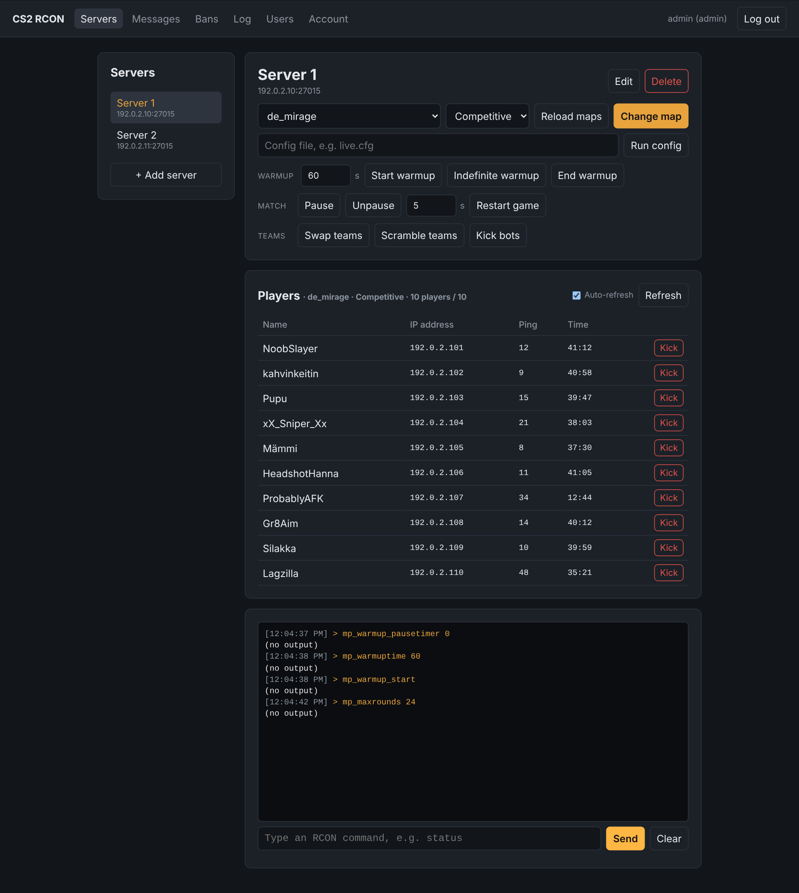

# CS2 RCON Web

A small web app for managing Counter-Strike 2 servers over RCON from a browser. It runs in Docker on any machine on the LAN, and admins log in from their own laptops or phones.



- Several CS2 servers in one place: pick one and manage it
- Change map and game mode, run configs, start/end warmup, restart, pause, swap/scramble teams, kick bots
- Live player list with IP, ping and connected time, and a Kick button
- List and remove SteamID and IP bans
- Raw RCON console with command history
- User accounts (admin / operator) and a log of who ran which command

## Setting it up at the LAN

### 1. What you need

- A machine on the LAN that can run Docker (Linux, or Windows/macOS with Docker Desktop). It can be the same machine as the game servers.
- That machine must be able to reach each CS2 server's game port over **TCP** (usually 27015).

### 2. Prepare the CS2 servers

Give every server an RCON password, either in its `server.cfg`:

```
rcon_password "something-long-and-secret"
```

or on the launch line: `+rcon_password something-long-and-secret`. Restart the server after changing it.

### 3. Start the tool

```sh
git clone https://github.com/Torpan-verkkopelit-ry/cs2-rcon-web.git
cd cs2-rcon-web
docker compose up -d --build
docker compose logs cs2-rcon-web
```

On the first start the logs show a generated password for the `admin` account:

```
Created initial admin account "admin".
Generated password: Nr5cxPAx8JmP_V5Z  (change it after logging in)
```

To pick the password yourself instead, set `ADMIN_PASSWORD` in `docker-compose.yml` before the first start.

### 4. First login

1. Open `http://<ip-of-the-docker-machine>:8080` in a browser.
2. Log in as `admin` with the password from the logs, then change it under **Account**.
3. Under **Users**, add an account for each admin. **Operators** can run commands; **Admins** can also add servers and manage users.
4. Under **Servers**, press **+ Add server** and enter a name, the server's IP, its port (27015) and its RCON password. Repeat for each server.
5. Pick a server and type `status` in the console. If you see the server's status, everything works.

### 5. During the event

- The data (users, servers, command log) lives in the `cs2-rcon-data` Docker volume, so it survives restarts and rebuilds.
- `docker compose restart` restarts the tool. `docker compose down` stops it and keeps the data.
- The **Log** tab shows every command: when, by whom, on which server, and whether it worked.

### Updating

```sh
git pull
docker compose up -d --build
```

### Backups

The database is a single SQLite file in the volume. To copy it out:

```sh
docker compose cp cs2-rcon-web:/data/cs2-rcon-web.db ./backup.db
```

### Locked out?

If you lose the admin password, `docker compose down -v` deletes the volume (all users, servers and the log). A fresh admin account is then created on the next start.

## Settings

Environment variables in `docker-compose.yml`:

| Variable | Default | Meaning |
| --- | --- | --- |
| `PORT` | `8080` | Port the web UI listens on inside the container (also change the `ports:` mapping) |
| `DATA_DIR` | `/data` | Where the SQLite database is stored (a Docker volume) |
| `ADMIN_USERNAME` | `admin` | First admin account, created only when there are no users yet |
| `ADMIN_PASSWORD` | *(generated)* | Password for that account; if empty, a random one is printed to the logs |
| `SECURE_COOKIES` | `false` | Set `true` when serving over HTTPS |
| `TRUST_PROXY` | `false` | Set `true` when running behind a reverse proxy |
| `RCON_DEBUG` | `false` | Set `true` to print every RCON packet sent and received to the container logs |

To serve the UI on port 80 instead of 8080, change `"8080:8080"` to `"80:8080"` under `ports:`.

## Using it

**Servers tab**, after picking a server:

- **Change map**: pick a map (it starts on the current one), or **Other / Workshop…** to type any map name or a Workshop ID. Picking a game mode (competitive, casual, wingman, deathmatch, arms race) at the same time sets `game_type`/`game_mode` and loads the map, which is when a mode change takes effect.
- **Run config**: runs `exec <file>`. Configs you've run are suggested next time.
- **Quick buttons**: start/end warmup, restart game, pause/unpause, swap teams, scramble teams, kick bots. Restart, swap and scramble ask for confirmation first.
- **Players**: current map and game mode, plus who is on the server with IP, ping and connected time. It refreshes every 10 seconds while the page is open, and each player has a **Kick** button.
- **Bans**: **Load bans** lists SteamID bans (`listid`) and IP bans (`listip`). **Unban** removes one and saves the ban list (`writeid` / `writeip`), so the unban lasts after a server restart.
- **Console**: any RCON command; up/down arrows recall earlier commands. Every button's command and the server's reply show up here too.

**Log tab**: every command run through the tool, filterable by server.

## Troubleshooting

| Problem | What to check |
| --- | --- |
| "Cannot connect to …" | The server's IP and port, and that the Docker machine can reach it over TCP (firewall). |
| "Wrong RCON password" | The password in the tool matches `rcon_password` on the server; edit the server and re-enter it. |
| Commands run but show "(no output)" | Normal for commands that print nothing (e.g. `mp_warmup_end`). |
| Something else looks wrong | Set `RCON_DEBUG: "true"`, run `docker compose up -d`, try again, and check `docker compose logs` for the raw `[rcon …]` lines. |

## Security notes

- This is meant for a trusted LAN. Don't expose it to the internet; if you have to, put it behind a reverse proxy with HTTPS and set `SECURE_COOKIES` and `TRUST_PROXY` to `true`.
- RCON passwords are stored in the app's database so it can log in to the servers. They are never sent to the browser, but anyone with access to the Docker volume can read them.
- Login is rate limited, and passwords are stored hashed (scrypt).

## Future ideas

- Ban a player straight from the player list
- Per-server saved command presets and config lists
- Chat with players (`say`) from the UI

## Development

Requires Node.js 22.13 or newer (uses the built-in `node:sqlite`).

```sh
npm install
npm test        # builds and runs the tests
npm run dev     # builds and starts on http://localhost:8080, data in ./data
```

The tests use a mock RCON server (`test/mock-rcon.ts`) that has a mode imitating a real CS2 server's replies.
